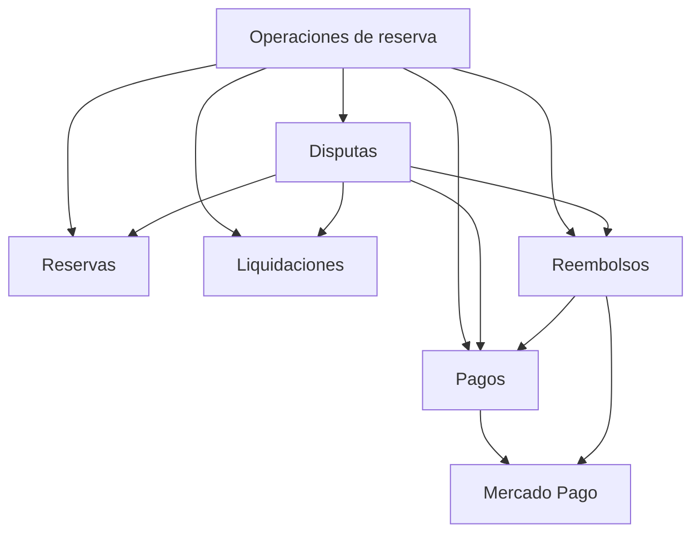

# Plan de refactorización del backend

**Seminario Integrador · Propuesta para revisión**  
**Base revisada** — Merge local `026a42f` (PR #14), PR #13 y cambios locales posteriores.

## 1. Objetivo y alcance

Rediseñar los flujos de reservas, cancelaciones, pagos, reembolsos, liquidaciones, reclamos, contracargos y bloqueo de anunciantes. El diseño parte de las responsabilidades del negocio. Los servicios actuales se conservan, reemplazan o eliminan según su responsabilidad en la estructura final.

La implementación se hace por bloques aprobados. Este archivo describe el plan. Las rutas, los permisos y las respuestas que consume Angular se mantienen durante la transición. Las migraciones se ensayan en una base descartable antes de aplicarlas al entorno correspondiente.

## 2. Reglas de estructura

- Cada módulo NestJS tiene su carpeta propia y un único archivo `*.module.ts`. Si se justifica un módulo nuevo, se crea una carpeta hermana bajo `back/src/`.
- Cada controlador delega en un servicio de su módulo. Entre módulos se llaman servicios públicos con IDs, datos de entrada y resultados explícitos.
- El servicio dueño obtiene los datos mediante su repositorio y aplica las reglas de negocio. Los repositorios encapsulan TypeORM, consultas, bloqueos y escrituras. Sus tokens quedan privados.
- Cada archivo de entidad contiene una clase de entidad con atributos, relaciones y decoradores de mapeo. Estados, tipos y causas persistidos se obtienen desde Catálogos. Las validaciones y transiciones quedan en servicios.
- Se crean DTO para contratos concretos, proveedores para integraciones externas y servicios adicionales cuando representan un flujo con responsabilidad propia. Un módulo que solo coordina servicios puede carecer de entidades y repositorio propios.
- El servicio que coordina una operación local comparte la transacción con los servicios participantes. El acceso al ORM queda dentro de los repositorios. Cada servicio escribe los datos que le pertenecen.

## 3. Estructura objetivo

Cada fila identifica una carpeta y el único módulo que le corresponde. Se listan los módulos afectados por el rediseño.

| Carpeta bajo `back/src/` | Módulo | Responsabilidad y servicio público |
|---|---|---|
| `reservas/` | `ReservasModule` | `ReservasService` posee la reserva, sus fechas, ingreso, reprogramaciones y cambios de estadía. Usa Disponibilidad para el calendario. |
| `cancelaciones/` | `CancelacionesModule` | `CancelacionesService` posee la solicitud y su decisión. Consulta la reserva, aplica su política y coordina el efecto sobre la estadía y el eventual reembolso. |
| `pagos/` | `PagosModule` | `PagosService` posee el registro del pago, sus referencias externas, sus transiciones y el saldo contabilizado. Expone operaciones de lectura y escritura sobre ese registro. |
| `mercado-pago/` | `MercadoPagoModule` | `MercadoPagoService` expone la integración a los módulos consumidores. El adaptador, su interfaz y la traducción de respuestas externas viven en `proveedor/`. |
| `reembolsos/` | `ReembolsosModule` | `ReembolsosService` posee la solicitud de devolución, calcula el importe disponible consultando a Pagos y registra la ejecución y confirmación. |
| `liquidaciones/` | `LiquidacionesModule` | `LiquidacionesService` posee la retención, el congelamiento y la resolución de fondos. Es dueño del estado, importe, referencia y fechas de la liquidación. |
| `reclamos/` | `ReclamosModule` | `ReclamosService` posee el expediente, sus permisos, plazo, evidencias, mensajes y decisión. Pide efectos a Reservas, Liquidaciones o Reembolsos. |
| `disputas/` | `DisputasModule` | `DisputasService` posee el expediente de contracargo y su resolución. Coordina los efectos del resultado con Pagos, Reservas, Liquidaciones y Reembolsos. |
| `usuarios/` | `UsuariosModule` | `UsuariosService` posee la cuenta, los cambios de acceso y la apelación. La baja y sus efectos sobre otros módulos se coordinan desde un servicio de aplicación. |
| `usuarios-consulta/` | `UsuariosConsultaModule` | Mover el módulo de consulta existente a su carpeta. Expone la lectura mínima que Seguridad necesita para verificar la sesión. Es una etapa compatible mientras se revisa el cableado de Seguridad, Auth y Usuarios. |
| `bloqueo-anunciante/` | `BloqueoAnuncianteModule` | `BloqueoAnuncianteService` coordina el bloqueo administrativo y el procesamiento por reserva. Pide a Usuarios el cambio de acceso. Su repositorio se justifica cuando persiste el seguimiento del lote y sus resultados. |
| `operaciones-reserva/` | `OperacionesReservaModule` | Coordina checkout, webhook y resolución administrativa de liquidaciones cuando cruzan módulos. Usa servicios públicos y conserva las rutas actuales. |
| `catalogos/` | `CatalogosModule` | `CatalogosService` consulta estados, tipos, orígenes, categorías y causas persistidos mediante su repositorio. |
| `disponibilidad/` | `DisponibilidadModule` | `DisponibilidadService` posee el calendario y sus bloqueos. Reservas solicita reservar, mover o liberar fechas. |

### Qué pasa con los tres módulos de Pagos

| Archivo actual | Destino |
|---|---|
| `pagos/pagos.module.ts` | Queda como único módulo de `pagos/`. Los endpoints de checkout, webhook y conciliación que coordinan varios dominios pasan a `operaciones-reserva/`, conservando el prefijo HTTP `/pagos`. |
| `pagos/pagos-persistencia.module.ts` | Se elimina al integrar el registro de `Pago` y su repositorio privado en `PagosModule`. Reembolsos y Disputas usan `PagosService`. |
| `pagos/pasarela.module.ts` | Se reemplaza por `mercado-pago/mercado-pago.module.ts`. El proveedor sale de la carpeta de Pagos y queda accesible a través de `MercadoPagoService`. |

También se retira `reservas-consulta/` cuando Reservas exponga sus consultas y la proyección de sus respuestas. En la copia revisada, `reembolsos/` ya tiene un único módulo. El antiguo `ReembolsosAplicacionModule` aparece en Git como eliminado localmente.

### Carpetas mínimas por módulo

```text
cancelaciones/
├── cancelaciones.module.ts
├── controller/
│   └── cancelaciones.controller.ts
├── dto/
│   ├── solicitar-cancelacion.dto.ts
│   └── resolver-solicitud-cancelacion.dto.ts
├── entity/
│   └── solicitud-cancelacion.entity.ts
├── repository/
│   ├── cancelaciones.repository.interface.ts
│   └── cancelaciones.repository.ts
└── service/
    └── cancelaciones.service.ts
```

Este ejemplo traslada la entidad y los DTO existentes. Se mantiene la tabla de solicitudes. Se crea un archivo adicional cuando corresponde a un contrato, una entidad, una integración o un caso de uso con responsabilidad propia.

## 4. Dependencias entre servicios

La flecha indica quién llama a quién. Se muestran las dependencias principales del rediseño.



- **Cancelaciones, Reclamos y Bloqueo** pueden llamar a Reservas, Liquidaciones y Reembolsos para efectos de sus casos de uso. Reservas no necesita importar esos módulos para cambiar sus propios datos.
- **Aplicación de devoluciones** se coordina desde Operaciones de reserva. Reembolsos expone confirmaciones aún pendientes de aplicar. Operaciones solicita los efectos a Reservas y Liquidaciones y marca la aplicación por ID de reembolso dentro de la misma transacción local. Así Reembolsos no depende del servicio completo de Reservas.
- **Usuarios y Seguridad** conservan una consulta de cuenta acotada para autorización. Las operaciones de baja que consultan obligaciones de reservas, pagos o liquidaciones se coordinan en el servicio que atiende la baja. Cada módulo aporta su propia consulta. Esto reemplaza las consultas operativas cruzadas que hoy ejecuta `UsuariosRepository`. Antes de moverlas se comprueba el grafo de importaciones de Auth, Seguridad y Publicaciones.
- **Lecturas combinadas** se arman en el servicio responsable de la respuesta. Si el panel de liquidaciones requiere estadía o nombres de participantes, se consultan lotes de IDs mediante los servicios dueños. Se conserva la forma de respuesta de Angular y se evita una consulta por fila.
- **Catálogos** se consulta desde los servicios. Un identificador estable puede existir en código como criterio de búsqueda o contrato externo. El registro, sus relaciones y los parámetros vigentes se obtienen de la base. Se revisan los ciclos de NestJS antes de retirar módulos de transición.

## 5. Datos y políticas

| Dato | Diseño |
|---|---|
| Estados y valores de negocio persistidos | Reutilizar `Estado` y `Ambito` con el vínculo que corresponda. Migrar enums de tipo y origen de reembolso, origen de disputa, categoría y resolución de reclamo, visibilidad de mensajes y causas o actores de cancelación. Conservar los códigos existentes cuando forman parte de la API. |
| Política de cancelación | Persistir tramos, porcentajes y vigencia en Cancelaciones. El servicio lee la política y calcula el importe. Propuesta a validar: guardar la versión contratada o sus condiciones junto con la reserva. |
| Intentos de ingreso y plazo de reclamo | Persistir los parámetros en el módulo dueño de la regla. Reservas y Reclamos los leen desde sus repositorios y ejecutan sus validaciones. |
| Estado de estadía | Reservas lo calcula a partir de fechas y datos de la reserva. La respuesta usa los códigos acordados con el frontend. |
| Devolución en curso | Consultar la devolución asociada y su estado persistido. La observación queda como descripción. |
| Datos de la pasarela | Los estados externos se traducen en el proveedor. Pagos y Reembolsos trabajan con resultados del servicio de integración. |

Las migraciones crean las estructuras y preservan los datos históricos. `npm run db:seed` carga el catálogo y las políticas iniciales. La prueba de carga verifica que dos ejecuciones conserven los datos existentes y no dupliquen registros. Si una migración necesita filas de catálogo para validar claves foráneas, el orden explícito será crear estructuras, cargar el catálogo, vincular las filas históricas y validar las restricciones.

## 6. Cambios por bloque y aceptación

### 1. Cancelaciones como flujo piloto

- **Crear** `back/src/cancelaciones/` con módulo, controlador, servicio y repositorio propios. Mover `solicitud-cancelacion.entity.ts`, los DTO de solicitud y resolución, y las consultas y escrituras de solicitudes que hoy están en `reservas/repository/`.
- **Modificar** `reservas/service/reservas.service.ts` y su controlador. Cancelaciones posee la solicitud. Reservas expone la operación que cancela la estadía y solicita liberar el calendario.
- **Modificar** `reembolsos/service/reembolsos.service.ts` en lo necesario para identificar la solicitud de origen. Usar una identidad estable basada en el ID de la cancelación y conservar la idempotencia de las devoluciones existentes. Revisar cómo vincular solicitudes históricas antes de exigir la nueva relación.
- **Verificar** permisos, rutas y respuestas actuales. Dos resoluciones simultáneas deben producir una sola devolución. Si falla la liberación de fechas, se revierte la aprobación y los demás efectos locales.

### 2. Pagos y Mercado Pago

- **Consolidar** `pagos.module.ts` y `pagos-persistencia.module.ts` en `pagos/`. El registro y los cambios sobre `Pago` quedan en `PagosService`.
- **Crear** `mercado-pago/` para el servicio de integración y su proveedor. **Crear** `operaciones-reserva/` para mover checkout, webhook y conciliación de pagos que cruzan dominios.
- **Verificar** el grafo de módulos, las rutas actuales de Pagos, los permisos del estado de pago y la validación de la firma del webhook. Un aviso repetido debe conservar el resultado sin duplicar operaciones.

### 3. Reembolsos y conciliación

- **Modificar** el servicio y el repositorio de Reembolsos. Centralizar cobertura, saldo, devolución manual o automática y consulta de confirmaciones pendientes.
- **Mover** la coordinación de `reserva-reembolso-aplicacion.service.ts` y `reembolsos-reconciliacion.service.ts` a Operaciones de reserva. Los servicios dueños aplican sus propios cambios. Mover también el cálculo de cobertura de `reserva-bloqueo-devolucion.service.ts` a Reembolsos.
- **Persistir** el vínculo de origen y la aplicación de cada reembolso. Conservar las claves de idempotencia existentes y distinguir qué devoluciones históricas ya aplicaron sus efectos antes de habilitar el reprocesamiento.
- **Verificar** reintento tras confirmación externa, caída antes del guardado local, dos devoluciones parciales distintas y un contracargo que ya revirtió el dinero en la pasarela. La conciliación busca pendientes de aplicar en vez de recorrer todos los aprobados.

### 4. Liquidaciones e ingreso

- **Retirar** `reserva-liquidaciones.service.ts`. Mover las operaciones de código de alojamiento a Reservas. Dar a Liquidaciones el control exclusivo de los fondos y mover a Operaciones de reserva la coordinación administrativa entre dominios.
- **Modificar** `liquidaciones/service/liquidaciones.service.ts` y las proyecciones de Reservas. La API conserva `estado_liquidacion` y los demás campos que usa Angular. La tabla de liquidación se convierte en fuente de esos datos después de reconciliar los valores históricos.
- **Verificar** acceso al código por el inquilino, validación por el anunciante, bloqueo por intentos y resolución por administrador. Confirmar primero si `reportar-problema` debe abrir un reclamo o mantener su efecto actual de revisión.

### 5. Reclamos, Disputas y Bloqueo

- **Modificar** `reclamos/service/`, `disputas/service/`, `bloqueo-anunciante/service/` y `usuarios/service/`. Cada expediente usa su ID para coordinar devoluciones o cambios locales. Usuarios vuelve a ser el dueño de las escrituras de acceso a la cuenta.
- **Mover** `usuarios-consulta.module.ts` y su consulta de sesión a `usuarios-consulta/`. El repositorio de Bloqueo pasa a guardar el seguimiento administrativo, con resultado por reserva, si se adopta ese registro. Retirar las escrituras duplicadas sobre `Usuario` desde ese repositorio.
- **Retirar** los dos servicios de bloqueo específicos de Reservas cuando sus decisiones de estadía y sus cálculos estén en Reservas y Reembolsos, respectivamente.
- **Verificar** que un fallo parcial del lote pueda retomarse, que repetir una resolución no duplique devoluciones y que mensajes internos, evidencias y apelaciones conserven los permisos vigentes.

### 6. Limpieza y retiro de compatibilidad

- Integrar las reglas de estadía y mutaciones de `reserva-decision.service.ts` y `reserva-ciclo-vida.service.ts` en los servicios dueños. Retirar esos servicios una vez migrados todos sus consumidores.
- Revisar `reserva-reprogramacion.service.ts`, `reserva-notificaciones.service.ts` y `reserva-finalizacion.service.ts`. Mantener un servicio separado únicamente donde haya una operación con responsabilidad clara, como la tarea programada o el flujo de reintentos de notificación.
- Completar la eliminación de enums y valores de negocio persistidos en código. Comparar las respuestas que consume el frontend y recién después retirar los campos duplicados de liquidación en Reserva.
- Verificar compilación, lint, pruebas de integración y concurrencia sobre base descartable. Confirmar que cada carpeta de módulo tenga un solo `*.module.ts`, que los repositorios no se exporten y que las entidades se limiten a su mapeo.

## 7. Decisiones a confirmar por bloque

1. **Políticas históricas** — Confirmar qué versión se asigna a reservas existentes si todavía no registran sus condiciones de cancelación.
2. **Reporte de problemas** — Confirmar si la ruta existente inicia un expediente de Reclamos o solo solicita revisión de fondos.
3. **Devoluciones históricas** — Definir qué evidencia acredita que un reembolso ya tuvo efecto sobre su reserva y cómo revisar los casos ambiguos antes de activar el reprocesamiento.
4. **Bloqueo de anunciantes** — Confirmar si se necesita un lote persistido con reintentos por reserva y qué información debe mostrar administración.

La primera revisión de implementación sería el **bloque 1 de Cancelaciones**. El resto queda en el plan para aprobación por partes.
